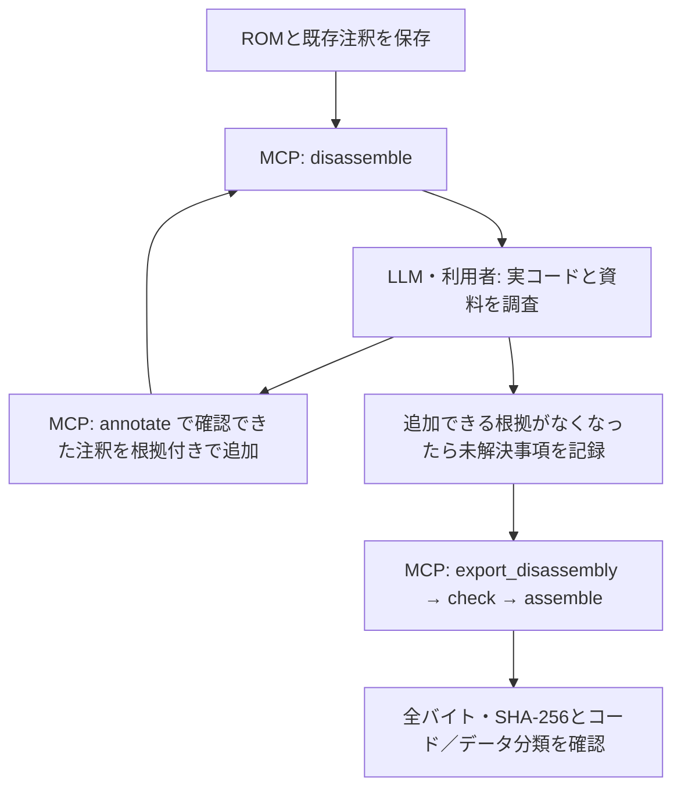

# MCPとLLMで逆アセンブルを進める手順

NESのROMから、命令・データ・ラベル・コメントを整理した、再利用できるNESASMソースを生成する手順です。
MCPサーバーが解析とソース生成を行い、LLMまたは利用者が実コードと資料を読んで注釈を追加し、再解析します。
サーバー自体はLLMを呼び出しません。

注釈の全項目は[逆アセンブラのリファレンス](reference/disassembler.md)、
実ROMでの調査例は[Rockman5のコード追跡改善と検証](disassembly-tracing-investigation.md)を参照してください。
以下のJSONは注釈ファイルの内容、または名前を指定したMCPツールの引数です。JSON-RPCの通信全体ではありません。

## 到達したい状態と役割

実用的なソースには、次の二つが必要です。

- **再現性**: 元のROMとヘッダ込み全バイトが一致して再アセンブルできる。
- **読みやすさと分類の根拠**: 確認したルーチンは命令、確認した表はデータとして出力され、
  名前・コメントから用途と根拠をたどれる。未確認の部分は未分類として残す。

バイト一致だけでは分類の正しさを証明できません。データを誤って命令にしても、同じバイトになる場合があります。
また、`.db` は確定したデータにも未分類のバイトにも使います。`unknown_range` と注釈の `regions` を併せて判断します。
同じ値が16バイト以上続く `.ds` も、実行可能なコードがないことの証明ではありません。

| 担当 | 行うこと |
|---|---|
| MCPサーバー | 命令のデコード、到達経路と既知の状態の追跡、参照・課題と注釈の修正案の提示、注釈ファイルの更新・検証・根拠の記録、ソース生成と往復検証 |
| LLM・利用者 | 資料と実バイトの照合、呼出し規約や表の範囲の推論、追加する注釈と根拠の判断、結果の評価 |



## 1. 入力と作業先を用意する

MCPクライアントから、`nesasm-mcp --root <プロジェクトの絶対パス>` へ接続します。
設定例は[README](../README.md#mcpサーバ)にあります。
ROM、注釈、依存ファイル、出力先はこのルート内に置きます。
注釈内の `rom`・`base` とMCPツールのパスはすべて**ルート基準**です。
注釈ファイルがサブディレクトリにあっても、その親からの相対パスにはしません。

例:

```text
project/
  roms/game.nes
  annotations/game.disasm.json
  notes/evidence.md
  generated/iteration-01/
  build/iteration-01/
```

入力ROMとパッチのサイズ・SHA-256、既存注釈、資料の版と文字コードを記録します。
原作と改造版は別の入力として扱い、原作のアドレス・表の長さ・用途を改造版へ無条件に流用しません。
入力ROMへの書込みや、解析のためのパッチ再適用は行いません。
既存の手編集済みソースも保持し、新しいディレクトリへ出力します。

`inspect_rom` でヘッダ、mapper、PRG/CHRのサイズ、割り込みベクタ、警告を確認します。

```json
{"rom": "roms/game.nes"}
```

新規の注釈ファイルは次のように始めます。既存注釈がある場合は、それを保存して作業用コピーを使います。

```json
{
  "rom": "roms/game.nes",
  "options": {
    "address_comments": true,
    "auto_ram_labels": true,
    "split_banks": true
  }
}
```

`mapper4_fixed_prg_16k: true` は、mapper 4で最終2PRGバンクが$C000/$E000に固定される場合だけ追加します。
mapper番号だけで実行中の配置が固定だとは判断しません。
生の `.bin` はリファレンスの `load_address` とraw出力の手順を確認してください。

注釈ファイルは `annotate` で作成・更新します（手順4）。新規作成は `create` で行います。

```json
{
  "annotations": "annotations/game.disasm.json",
  "create": {"rom": "roms/game.nes"},
  "operations": [
    {"op": "set", "kind": "options",
     "item": {"address_comments": true, "auto_ram_labels": true, "split_banks": true}}
  ]
}
```

注釈ファイルの名前は `.disasm.json` で終わる必要があります。手で編集することもできますが、
次の `annotate` で正規の書式に整えられます。ファイルを書き込まずに試す場合は、同じ注釈内容を
`inline` に渡します。`annotations` と `inline` は同時には指定しません。

```json
{
  "inline": {"rom": "roms/game.nes", "options": {"address_comments": true}},
  "output": "generated/iteration-01/game.asm"
}
```

このJSONは `disassemble` の引数です。`inline` の内容はサーバーに保存されないため、別途記録します。

## 2. 初回解析を基準として保存する

`disassemble` を呼びます。`output` は生成するファイル名の基準ですが、このツールはファイルを書き込みません。

```json
{
  "annotations": "annotations/game.disasm.json",
  "output": "generated/iteration-01/game.asm",
  "issues": {"offset": 0, "limit": 1000},
  "routines": {"offset": 0, "limit": 1000},
  "ram": {"offset": 0, "limit": 1000}
}
```

`success`、`diagnostics`、`verification.matched`、`verification.mismatch_count` を確認します。
ソースを生成できたことと、往復検証が一致したことは別の結果なので、`success` だけで判断しません。
不一致なら、その原因を確認してから注釈の範囲を広げます。

保存する内容は、入力のハッシュ、実行時の注釈全文、サーバーの版、ツールの引数、応答です。
入力のハッシュとサーバーの版は、`disassemble`／`export_disassembly` の応答の `inputs`
（ROM・ベースROM・注釈ファイルのSHA-256、`server_version`）にあります。
集計はPRGとCHRを分け、`summary.instructions`、ラベル・ルーチン数、PRGの
`code_bytes`／`data_bytes`／`unknown_bytes`、issuesの種類別件数を記録します。
未分類バイト数を「未解析命令数」とは呼びません。

`issues`・`routines`・`ram`・`diffs` はページ付きです。`total` と取得済みの件数を比べ、
残りがあれば `offset` を増やして同じ条件で取り直します。各ページの上限は1000件です。
`view` は最大2000行で、応答は同じく `total`・`offset`・`items` を持ちます。
先頭ページだけを全結果として扱わないでください。
各呼出しで解析するため、関連する問い合わせはできるだけ一つの `disassemble` にまとめます。

## 3. 未解決箇所を一つ選び、実コードを読む

最初から全未分類領域を埋めようとせず、目的に近いルーチンや変更箇所を選びます。
呼出し元、直前のバンク切替、参照するRAM、間接ジャンプのポインタ設定を前後の範囲で調べます。

`disassemble` の問い合わせ例:

```json
{
  "annotations": "annotations/game.disasm.json",
  "output": "generated/iteration-01/game.asm",
  "view": {"bank": 30, "from": "$DE90", "to": "$DED4", "limit": 200},
  "xrefs": ["$DEB1", "$FF3D"],
  "routines": {"offset": 0, "limit": 1000},
  "issues": {"kind": "unresolved_bank", "offset": 0, "limit": 1000}
}
```

bankは8 KiB単位の**10進数**です。上のアドレスやbank番号はRockman5の調査を例にしたもので、
他のROMにそのまま適用する値ではありません。`xrefs` はラベル名、シンボル名、CPUアドレスを指定でき、
同じCPUアドレスを持つバンクの結果は各参照のbankを見て区別します。

追跡されていない `.db` の内容を調べる場合は、`inspect_rom` で狭い範囲の実バイトをデコードします。

```json
{
  "rom": "roms/game.nes",
  "disassemble": {"bank": 27, "address": 32768, "length": 32}
}
```

ここでの `length` は命令数、`address` は数値です。`hexdump` の `length` はバイト数です。
この範囲表示は到達経路を証明するものではありません。命令として読めたことだけを理由に
`entry_points` や `code` 領域へ追加せず、呼出し・分岐・ベクタ・表からの根拠を確認します。

### バンク切替の例

```asm
    lda #$1B
    jsr SetPrgBankPair
    jsr $8000
    lda #$1C
    jsr SetPrgBankPair
    jsr $8000
```

`SetPrgBankPair` が、Aのバンクを$8000、A+1を$A000へ配置して戻ると実コードで確認できれば、
二つのJSR $8000はそれぞれbank $1B、bank $1Cの先頭へ到達します。
ルーチン名だけで意味を決めず、マッパーへの書込み、全復帰経路、途中の呼出しによる変更と復元を調べます。

サーバーが解決できない場合は、確認した呼出し箇所だけに `references` を追加できます。
同時に、そのバンクを対象の窓で表示する `banks` の配置も確認します。
以下は既存注釈へ追加する項目の例で、単独の完成した注釈ファイルではありません。

```json
{
  "banks": [{"bank": 27, "org": "$8000"}],
  "references": [{"bank": 30, "address": "$DEB1", "target_bank": 27}],
  "comments": [{
    "bank": 30,
    "address": "$DEB1",
    "text": "直前のA=$1Bと切替処理・復帰時の復元を実コードで確認した呼出し先。"
  }]
}
```

`references.address` は飛び先$8000ではなく、**参照する命令の先頭$DEB1**です。
`references` は推定したバンクより優先するため、根拠がない値を入れると誤ったコードを追跡できます。
また、現在の `banks` は物理バンクごとに一つのorgを指定する方式です。
同じ物理バンクが複数のCPU窓で使われるケースを、一つの指定で全面的に解決したとは扱いません。

### 実行時に選んだバンクを読む参照

同じ配置のデータが複数のバンクにあり、共通ルーチンが「いま$A000-$BFFFに入っているバンク」を読む場合、
参照先は意図的に動的です。`target_bank` で一つに固定すると誤りになり、`comments` だけでは未解析の
`unresolved_bank` と区別できません。実コードで切り替えを確認したら、`target_window` で
「確認済みの動的参照」として記録します。

例：Rockman5.nes BANK $1E（30）のルーチン$D829は、$F6（$A000窓のバンク要求値）をスタックへ保存し、
StageDataBank（$27）を$F6へ設定して$FF43（SetPrgBanks。$FF53-$FF5EでMMC3 R7へ$F6を書く）を呼び、
ステージデータバンクのタイル・属性の表を読んでから、$F6を復元して再び$FF43を呼びます。

```json
{"op": "upsert", "kind": "references",
 "item": {"bank": 30, "address": "$D849", "target_window": "$A000"},
 "evidence": "$D829-$D830でStageDataBank($27)を$F6へ設定しSetPrgBanks($FF43)がR7へ書く。$D89B-$D89Eで復元。全ステージバンクが同じ位置に表を持つ"}
```

$D84F／$D855／$D85B／$D861（`lda $AE00,y` … `lda $B100,y`）も同じ根拠で追加します。

- 対象は窓の中の絶対アドレスを読む命令だけです。書込み、JSR／JMP、分岐には使えません。
  `target_bank` と同時には指定できず、根拠が必須で、ファイルには `"format_version": 3` が書かれます。
- その命令の `unresolved_bank` は消え、`disassemble` の `dynamic_references` に命令位置・読むアドレス・
  窓・候補バンク・根拠が載ります。注釈していない他の参照は `unresolved_bank` のまま残ります。
- ソースは `lda $AD00,y ; dynamic: reads the bank switched in at $A000` となり、特定バンクのラベルには
  置き換えません。読み取った値も定数として扱いません。表のバイトは各バンクで `regions` に記述します。
- `annotate` の `dynamic_references_added` や `baseline` の比較で、どの `unresolved_bank`（`issue_id`）が
  動的参照になったかを確認できます。

### 間接ジャンプと表の例

ポインタの下位・上位バイトをどこから読むか、索引の意味、有効な要素数、
要素ごとのバンク選択、無効な要素の有無を確認します。
分離した下位・上位表を指すissueが出ても、示された表の先頭だけでは長さは確定しません。
全候補を命令にする前に、境界や有効IDを資料と実コードで照合します。

```json
{
  "regions": [
    {"bank": 27, "start": "$8045", "length": 36, "type": "low_bytes", "pair": "$8069", "code_targets": true,
     "comment": "$802B/$8030が同じ索引で参照。上位表は確認した最初のハンドラ$808D直前まで。"},
    {"bank": 27, "start": "$8069", "length": 36, "type": "high_bytes"}
  ]
}
```

これもRockman5で確認した追加項目の例です。表自体はデータのまま、飛び先からコードを追跡します。
連続する16ビット表なら `pointers`、要素ごとの切替バンク表があれば `bank_table` を使います。
RTSで飛ぶ表は、保存値と飛び先の差を確認したうえで `adjust: -1` を指定します。
無効な要素を含む場合は有効範囲を分割し、無効部分は `bytes` 等にします。

## 4. 注釈と根拠を保存して再解析する

使う注釈を、確認できた事実に合わせて選びます。

| 確認した内容 | 記録する項目 |
|---|---|
| ROM内の名前・用途 | `labels`・`comments`。名前を付けるだけではコードの入口にならない |
| RAM・I/Oの名前・用途 | `symbols` と必要な `size` |
| 到達するコード入口 | `entry_points`。入口から追える範囲をコードとして扱う |
| データの範囲と形式 | `regions` の `bytes`／`words`／`text` 等 |
| ジャンプ表 | `regions` の `pointers`／`low_bytes`／`high_bytes`。コードの飛び先だけ `code_targets: true` |
| 参照先のバンク | `banks` と、必要な箇所だけ `references`（実行時に選んだ窓のバンクを読むなら `target_window`） |
| JSR直後の引数・戻らない呼出し | ルーチンの `entry_points.inline_bytes`／`no_return` |

`switch_banks` は、指定RAMにあるバンクを配置するだけでなく、呼出し元が知るその他のRAMを
変更しないというモデルを適用します。バンクが合っていても、この前提が成り立たなければ使いません。
`keeps_banks` も、全復帰経路で呼出し時のバンクが保たれるという根拠が必要です。
スレッドが同じSPへ戻ることだけでは、バンクの復元を証明できません。
`no_return` は、スケジューラを経て元の呼出し後へ再開する処理へ機械的に指定しません。

注釈はサーバーの推定より優先します。`regions.type: "code"` は範囲を強制的にデコードするため、
広い未分類範囲を命令化する目的では使いません。範囲全体がコードである根拠が必要です。

注釈は `annotate` の操作で追加・置換・削除します。`upsert` は項目全体を渡し、同じキー
（`references` なら bank と address、`regions` なら bank と start、`labels` なら name）の項目を置き換えます。
フィールド単位のマージはしないため、既存の項目を変えるときは、応答の `applied[].previous`
（置き換え前の項目）に変更を加えて送ります。

```json
{
  "annotations": "annotations/game.disasm.json",
  "expected_sha256": "<前回の annotate の sha256、または sha256_before>",
  "operations": [
    {"op": "upsert", "kind": "references",
     "item": {"bank": 30, "address": "$DEB1", "target_bank": 27},
     "evidence": "直前のA=$1Bと、SetPrgBankPairの全復帰経路での復元を実コードで確認"},
    {"op": "upsert", "kind": "comments",
     "item": {"bank": 30, "address": "$DEB1", "text": "bank $1B の先頭を呼ぶ"}}
  ]
}
```

- スクリプトで生成した大量の操作（表から作るラベルなど）は、ルート内のJSONファイルに `operations` と
  同じ形式の配列で保存し、`operations` の代わりに `"operations_file": "<ルートからの相対パス>"` で渡します。
  操作をツールの引数として出力し直さずに済み、ログには引数で渡した場合と同じ形式で記録されます。
- issuesの `suggestions` は、そのまま `operations` に使える形の修正案です。案は選択肢ごとに分かれ、
  `needs` に挙がったフィールド（表の `length` など）は null のままなので、実コードで確かめて埋めます。
  修正案は追跡できた経路から作ったもので、根拠の代わりにはなりません。
- 推定より優先される項目（`references`、`no_return`／`inline_bytes`／`switch_banks`／`keeps_banks` を
  持つ `entry_points`、`code` 領域、`code_targets` 付きの表）と推測（`hypothesis`）の項目には根拠が必須です。
  操作の `evidence` か、項目の `evidence` のどちらかに書きます。
- 同じ根拠を多数の項目に付けるときは、`operations` と並べて `"evidence": "..."` を1回だけ書きます。
  自身の `evidence` を持たない操作すべてに付き、各操作に書いた場合と同じに扱われます。
  根拠が異なる操作のまとまりは、呼び出しを分けるか、操作ごとに書きます。
- 操作の `evidence` は項目の `evidence`（文字列の配列）に追加され、注釈ファイルの中で項目と一緒に残ります。
  同じ文は二重に入りません。間違った根拠を消すときは、その文を除いた `evidence` を項目に付けて送ります。
  根拠を使うファイルには `"format_version": 2`（`target_window` を使うなら3）が書かれ、旧版のnesasmでは
  読めなくなります。
- 根拠は、注釈ファイルと同じ場所の `<名前>.disasm.log.jsonl` にも、操作、更新前後のSHA-256、
  命令数とコード／データ／未分類のバイト数、issues数とともに1行ずつ追記されます（履歴）。
  ソースの読者に向けた説明は、別途 `comment`／`comments.text` に書きます。
- ファイルを書き込むのは、全操作を適用でき、注釈が有効で、往復検証が一致し（`require_match`）、
  ファイルが `expected_sha256` から変わっていない場合だけです。`dry_run: true` で書き込まずに結果を確認できます。
- 書き込んだ場合、応答はログの行（`log_entry`）を繰り返しません。ログ（`<名前>.disasm.log.jsonl`）を見ます。
  反復を重ねて応答を小さくしたいときは `brief: true` を付けます。前後の要約（バンク別）を省き、
  `applied` は既存の項目を置き換え・削除した操作だけになります。前後の集計はテキストの要約に残ります。
- 応答の `summary_before`／`summary_after`、`issues_resolved`／`issues_introduced`／`issues_changed` で、
  変化した分類とissueを確認します。issueは `id`（種類・bank・アドレス、例 `unresolved_bank:30:$DEB1`）で
  照合し、同じissueのメッセージだけが変わったもの（表を領域で記述した間接ジャンプなど）は
  `issues_changed` に変更前のメッセージとともに入ります。

注釈JSONには未対応の `confidence` 等の独自フィールドを追加しません（読み込みでエラーになります）。
未確認の仮説は `"status": "hypothesis"` の項目として、推測した理由を `evidence` に付けて置きます。
推測の項目は通常の解析には適用されず、`export_disassembly` のソースにも入りません。
`disassemble`／`annotate` に `hypotheses: true` を指定すると、推測を確定とみなした試行の解析になります。
確かめられたら、`status` を外して（`confirmed` にして）根拠を足した項目で `upsert` します。
1つのキーには1項目しか置けないため、同じ場所について複数の推測を並べることはできません。
並べたい推測はノートに置きます。

```text
対象: ROM名・SHA-256、bank、CPUアドレス（必要ならファイルoffsetも）
観察: 呼出し元、ポインタ設定、表を読む命令、資料の箇所
判断: 注釈に追加する事実と適用範囲
未確認: 別経路、表の無効ID、改造版での差、動的な状態
検証: 再解析で変わった命令・データ・参照・issues、往復一致
```

一度に一つの原因、または関連する少数の項目を追加して再解析します。
応答（`annotate` の記録に入らない詳細）も反復ごとに保存し、新しい命令が呼出し経路と整合するか、表やパディングを誤認していないか、
`overlap`・`invalid_opcode`・`code_data_conflict` や不自然な参照が増えていないかを確認します。
新しいissueが出たことだけでは悪化とは限りません。新しく到達したコードの未解決問題か、誤った注釈かを調べます。
矛盾があれば、直前の注釈を見直します。

保存した以前の注釈と比べるときは、`disassemble` の `baseline` に以前の注釈ファイルを指定します。
以前の注釈での要約と、解消・新規・変化したissueを `id` で照合して返します。

```json
{
  "annotations": "annotations/game.disasm.json",
  "baseline": {"annotations": "annotations/iteration-01/game.disasm.json"}
}
```

サーバーの版も変える場合は、**同じ注釈で変更前後を比較してから**、追加注釈ありの結果を比較します。
解析回数・命令数・コード量の増加だけを改善の根拠にしません。

## 5. 改造版は差分と全体の両方から確認する

差分版の注釈は、対象ROMを `rom`、原作を `base` に指定します。

```json
{
  "rom": "roms/hack.nes",
  "base": "roms/game.nes",
  "options": {"address_comments": true, "split_banks": true}
}
```

差分版でも対象ROM全体をコード追跡しますが、ソース表示とissuesは差分に関係する範囲へ絞られます。
`summary.instructions` やbankのコード量は全体の解析結果です。
差分版のissues件数を、全体版のissues件数と同じ条件の数値として比較しません。

変更周辺が見えなければ、対象ROMの `base` を外した**別の注釈コピー**で全体を調べます。
必要なルーチンや表を差分ソースにも出したい場合は `patches` で出力範囲を広げます。
`patches` はコードの根拠や入口を追加する機能ではありません。
認識済み命令のオペランドだけが変更された場合は、差分範囲が命令全体へ拡張されます。
命令として認識されていなければ、範囲を広げるだけで命令化されるとは限りません。

原作・改造版で同じCPUアドレスに命令があっても、表の配置・飛び先・戻り方まで同じとは限りません。
それぞれの入力に対して注釈と検証結果を保存します。

## 6. ソースを生成し、独立して再ビルドする

確認できた注釈を使い、`export_disassembly` を呼びます。

```json
{
  "annotations": "annotations/game.disasm.json",
  "output": "generated/iteration-02/game.asm"
}
```

往復検証が一致した場合だけ、`.asm`・必要なバンクファイル・`.chr` を書き込みます。
生成後に手編集されたファイルは上書きしません。拒否されたら保護を解除するために編集を消すのではなく、
別の出力先を使います。注釈で表現できる修正は注釈に戻し、再生成可能な状態を保ちます。

続いて、`check` と `assemble` を別々に実行します。

`check`:

```json
{"input": "generated/iteration-02/game.asm"}
```

`assemble`:

```json
{"input": "generated/iteration-02/game.asm", "output": "build/iteration-02/game-rebuilt.nes"}
```

入力ROM・ベースROMと異なる出力先にし、診断、ヘッダ込み全ファイルのバイト一致、SHA-256一致を確認します。
一致しない場合は完成扱いにせず、最初の差分と生成した行を調べます。
CHR付きROMでは、`.chr` が対象ROMのCHR全体を元の順序で保持していることも確認します。

差分版のソースはベースPRGを通常1回の `.incbin` で読み、対象CHR全体を末尾から1回読み込みます。
ベースとのバンク対応が複数の連続区間になる拡張ROMでは、ベースの読込みも複数になる場合があります。
CHR RAMならCHRファイルはありません。全体版のCHR読込みは差分版と異なり、バンクファイルから行う場合があります。
mapper 4の固定16 KiB設定を使った場合は、最終2PRGバンクの統合ファイルと `.catbank` も確認します。

付属の `tools/trace_rom.py` は、ページ回収、生成、check、assemble、バイト／SHA-256比較、CHR、字下げを
まとめて検証できます。現在のハーネスは**ルート直下の注釈ファイルとCHR付きiNES ROM**を使う検証向けです。
差分版は、ベースPRGの `.incbin` が1個になる出力構成に限ります。
ベースの読込みが複数区間になる拡張ROMは、このハーネスではなく上記のMCP各工程と独立比較で検証します。
例えば注釈をルートの `game.disasm.json` に保存した場合:

```sh
python tools/trace_rom.py --server target/debug/nesasm-mcp.exe --root /path/to/project --annotations game.disasm.json --output generated/iteration-02/game.asm
```

サーバーのパスは実行環境に合わせます。Linux/macOSでは `.exe` を外します。
再ビルドROMは指定した出力の拡張子を `.nes` に変えた場所、レポートは `.report.json` へ保存されます。

## 7. 完了範囲と残る課題を報告する

終了条件は「`.db` がなくなったこと」ではありません。目的のルーチンやデータを根拠付きで整理でき、
追加できる根拠がなくなった箇所は未分類のまま説明できることです。

報告には、対象ROMとハッシュ、注釈・ソース・再ビルド・レポートのパス、確認した呼出し経路、
代表箇所の変更前後、コード／データ／未分類の量、issuesの内訳、全バイト一致と誤認防止の検証を含めます。
残る課題には、解決に必要な情報も書きます。例えば、表の有効ID、RAMの書込み経路、
スレッド登録先、実行時のバンク・ポインタ状態です。
実行時トレースが得られる場合も、観測した経路を根拠として扱い、未観測経路まで確定しません。

## LLMへの依頼文の例

次の文のパスと対象を置き換えて使えます。

```text
nesasm MCPを利用して、対象ROMの逆アセンブルソースを整理してください。
このリポジトリの docs/disassembly-workflow.md に従って進めてください。

プロジェクトルート: <絶対パス>
対象ROM: <ルートからの相対パス>
既存注釈: <相対パス、なければ新規作成>
解析資料: <パスと既知の文字コード>
目的: <理解・編集したいルーチンやデータ>
出力先: <入力と別の新規ディレクトリ>

最初に入力と既存注釈を保存・確認し、既存注釈での解析結果を記録してください。
MCPのview、xrefs、routines、ram、issuesと、必要な狭い範囲のinspect_romを使い、
呼出し元、バンク切替の復帰状態、間接ジャンプのポインタ、表の境界を調べてください。
実コードと資料で確認した入口・参照先・データ範囲だけを、根拠付きで注釈に追加し、
再解析と確認を繰り返してください。注釈はannotateで根拠（evidence）とともに追加し、
issuesのsuggestionsを使う場合も実コードで確かめてから適用してください。

未分類領域を線形に命令化せず、未知のバンクを都合のよい値で補わないでください。
原作と改造版の注釈を無条件に共有せず、表・パディング・インライン引数の誤認を確認してください。
注釈と結果を反復ごとに保存し、数値の増加だけで解析品質を判断しないでください。

入力ROM・パッチ・手編集済みソースを保持してください。
export_disassembly → check → assembleを実行し、入力と別の出力先で
ヘッダ込み全バイトとSHA-256の一致を確認してください。
完成した範囲、変更前後の代表例、検証結果、残る課題と必要な情報を報告してください。
```
